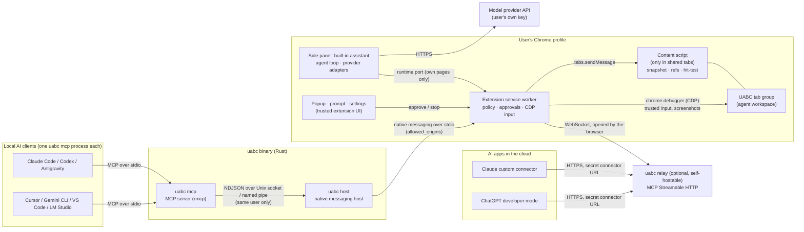

# Architecture

UABC lets AI operate the user's **own** browser profile, with their sessions,
cookies and 2FA intact, inside guard rails the user controls. Three kinds of AI
client reach the same gate ([ADR-0005](adr/0005-assistant-and-remote-access.md)):
the built-in assistant in the side panel, local MCP clients, and cloud AI apps
through an optional relay.



How this differs from the founding sketch: there is **no loopback TCP server**
(no `127.0.0.1:9222`). See [ADR-0003](adr/0003-local-ipc-security.md).

## Components

| Component | Code | Responsibilities | Trust |
|---|---|---|---|
| `uabc mcp` | `host/src/mcp.rs`, `format.rs`, `client.rs` | Speaks MCP to one AI client. Validates arguments, tracks the current tab and document id (stale-ref protection), formats results for LLMs, fences page content. Connects lazily through a `Link`, so the AI client may start before the browser. | Runs as the user; trusts nothing it receives from pages. |
| `uabc host` | `host/src/host.rs`, `native.rs`, `ipc.rs` | Started by Chrome. Bridges stdio ↔ IPC endpoint, multiplexes many AI sessions, re-numbers request ids, publishes a discovery record. **Makes no policy decisions.** | Router only. |
| `uabc relay` | `host/src/relay.rs` | Optional, runs anywhere. Accepts browsers on `/ws` (device id + secret, trust on first use; hashes only) and serves the same MCP tools over Streamable HTTP at each device's secret connector URL, forwarding commands as hop-C messages. **Makes no policy decisions.** | Sees relayed content in transit; cannot bypass the extension's gate. |
| Service worker | `extension/src/background/*` | The **policy enforcement point** for every client (native, remote, assistant): tab workspace, site grants and prompts, sensitive-field rules, kill switch, audit log. Executes commands, using CDP for input and screenshots. Holds the native and relay connections. | Trusted, user-controlled. |
| Built-in assistant | `extension/src/assistant/*`, `shared/runner.ts`, `ui/sidepanel.ts` | Agent loop in the side panel: provider adapters (Chat Completions, Anthropic Messages, Gemini), the TypeScript port of the MCP tool layer, the chat UI. Sends commands to the service worker over a port. | Trusted extension page; model output is rendered as text. |
| Content script | `extension/src/content/*` | Injected on demand into shared tabs only, isolated world. Builds snapshots, assigns refs, redacts sensitive values, hit-tests, draws Set-of-Marks, implements basic-mode fallbacks. | Runs next to untrusted page code, but in its own JS world. |
| Extension pages | `extension/src/ui/*` | Toolbar popup (status, stop/resume, recent activity), approval prompt, settings (modes, grants, input mode, log, diagnostics). | Trusted UI; renders page-derived strings with `textContent` only. |

## A request end to end

```mermaid
sequenceDiagram
    participant AI as AI client
    participant M as uabc mcp
    participant H as uabc host
    participant SW as Service worker
    participant P as Approval prompt
    participant CS as Content script
    participant Tab as Shared tab

    AI->>M: tools/call browser_click {ref: "12"}
    M->>M: add expect_doc (last snapshot of this tab)
    M->>H: {"type":"request","id":7,"method":"input.click",…}
    H->>SW: {"type":"request","id":101,"session":"s3",…}
    SW->>SW: paused? tab in UABC group?
    alt origin not yet approved for this AI client
        SW->>P: open a prompt naming this client
        P-->>SW: Allow this time / Always (any client) / Deny
    end
    SW->>CS: locate {ref: 12, expect_doc}
    CS->>CS: same document? scroll into view, hit-test
    CS-->>SW: {x, y} or OBSCURED / STALE_REF
    SW->>CS: ping: still the same document, on an allowed site?
    SW->>Tab: CDP Input.dispatchMouseEvent (trusted)
    SW->>CS: ping (did the document change?)
    SW-->>H: {"type":"response","id":101,"ok":true,"result":{navigated,url,title}}
    H-->>M: {"type":"response","id":7,…}
    M-->>AI: "Clicked. The tab navigated to …; call browser_get_state."
```

## Process model and lifecycle

- The **extension** calls `connectNative()` when its service worker starts.
  Chrome launches `uabc` with the caller origin as `argv[1]`. The open port
  keeps the MV3 service worker alive (Chrome 105+). If the host is missing,
  settings explain how to install it (the built-in assistant works without
  it), and an alarm retries every minute, so running `uabc install` later just
  works. The same alarm reconnects to the relay when remote access is on.
- The **side panel** opens a port to the service worker; its pings keep the
  worker alive while the panel is open. Closing the panel ends its session.
- The **host** waits for the extension's `hello`, binds
  `<UABC_HOME>/run/<instance>.sock` (or `\\.\pipe\uabc-<instance>`), writes
  `<UABC_HOME>/instances/<instance>.json`, and only then sends `welcome`. When
  Chrome closes stdin the host removes both and exits.
- Each **AI client** launches its own `uabc mcp`. On the first tool call it
  reads the discovery records (newest first, or `--target <label|id>`),
  connects, and says hello with the client's name from MCP `clientInfo`.
  If the browser restarts, the next call reconnects and re-selects the tab the
  client was working in.
- **Several browser profiles** each run their own host. Users name them in
  settings ("Work", "Personal") and choose with `uabc mcp --target work`.

## State

| State | Where | Lifetime |
|---|---|---|
| Settings, always-allowed sites, activity log, assistant API keys and providers, relay device id and secrets | `chrome.storage.local` (trusted extension contexts only) | Persistent; cleared by uninstalling the extension. |
| "Allow this time" grants, current tab per AI session | Service worker memory | Until the AI client disconnects (for the assistant: until its panel closes). |
| Assistant conversation | Side panel memory | Until the panel closes or *New chat*. |
| Relay device records (hashes) | `<relay data dir>/devices.json` | Persistent on the relay. |
| Refs and document id | Content-script world | Until the document unloads. |
| Discovery records, sockets, `host.log` | `UABC_HOME` (`~/.uabc`, `%LOCALAPPDATA%\uabc`) | While the host runs; the log rotates at 5 MB. |

## Perception model

`browser_get_state` returns, by default, what is **on screen**:

```
Tab 655791567 · https://example.com/contact · "Contact us"
Viewport 1280×800 · at the top, 1840px more below
<untrusted-web-content origin="https://example.com">
[1] link "Home" → /
[2] textbox "Full name" value="" required
[3] combobox "Country" value="Choose…" options: Choose… | Bangladesh | India, … (195 total)
[4] textbox "Password" value="(hidden)" password
[5] checkbox "I agree to the terms" unchecked
[6] button "Send message"
… 12 more element(s) below (scroll down)
</untrusted-web-content>
```

- **Interactive elements:** native controls; ARIA widget roles; positive
  `tabindex`; `onclick` attributes; and the outermost `cursor: pointer`
  element. That last rule catches `div`s with click handlers without listing
  their children.
- **Traversal:** light DOM, open *and closed* shadow roots, and same-origin
  iframes. Cross-origin frames are counted and reported (planned for M1).
- **Names:** a pragmatic subset of accname. Values are redacted for sensitive
  fields. States: checked, disabled, required, expanded, selected, focused,
  opens-new-tab and more.
- **Notes:** a page that is still loading, an open modal dialog (named), and
  un-inspected frames.
- **Screenshots:** in CSS pixels, so a point in the image is a valid
  `browser_click {x, y}`. With `marks` (default), numbered badges equal to the
  refs are drawn in a closed shadow root and removed right after capture.

## Extending UABC: adding a tool

1. **Extension.** Add a handler to `extension/src/background/commands.ts`
   (resolve the tab with `tabFor`, gate with `pageAccess` *before*
   `withTabLock`). Add content-side code in `extension/src/content/` if it needs
   the DOM.
2. **Protocol.** Document the method in [protocol.md](protocol.md).
3. **MCP.** Add a typed argument struct and a `#[tool]` method in
   `host/src/mcp.rs` with honest annotations (`read_only_hint`,
   `destructive_hint`), and a formatter in `format.rs`.
4. **Assistant.** Mirror it in `extension/src/shared/tools.ts` (same name and
   description), `runner.ts` and `format.ts`. The parity tests in
   `extension/test/runner.test.ts` fail until the descriptions match.
5. **Tests.** Add an e2e test in `e2e/uabc.test.mjs` against a fixture page.
   Security-relevant behaviour must have a negative test.

## Performance notes

- One snapshot is a single DOM pass in the page process. The fixture pages take
  milliseconds; very large pages (tens of thousands of nodes) are capped by
  `max_elements` and the viewport filter.
- Native messaging: host→extension messages are small commands (well under
  Chrome's 1 MiB limit, enforced). Extension→host messages may be large
  screenshots (Chrome allows 64 MiB). JPEG quality 70 at 1280×800 is about
  100–200 KB.
- The host and MCP server idle at about 6 MB RSS each.
